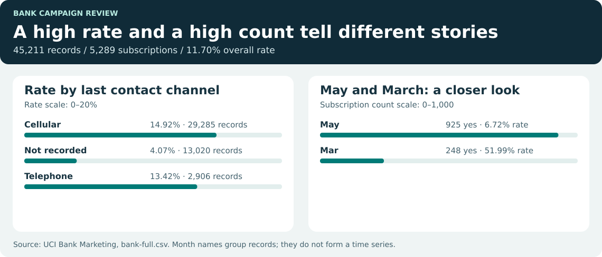
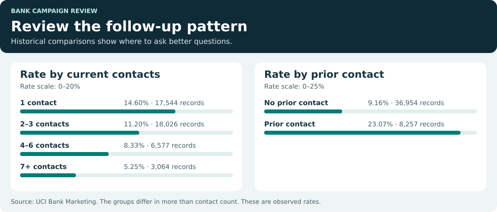

# Bank Campaign Review

**A marketing team has 45,211 campaign records. The next question: what should it look at before planning another round of calls?**

This case reviews a Portuguese bank's phone campaign for term deposits. It starts with a simple scorecard, then checks whether the story changes when we look at channel, call frequency, and campaign history.

[Open the dashboard file](dashboard/Bank_Campaign_Dashboard.html) · [Explore the SQL](docs/SQL_WALKTHROUGH.md) · [Build it in Power BI](power-bi/BUILD_GUIDE.md)

Download or extract the project and open `dashboard/Bank_Campaign_Dashboard.html` in a browser. It has two pages and works offline. If you're browsing on GitHub, download the HTML to run it.

## 1. Start with what happened

| Measure | Result |
|---|---:|
| Campaign records | 45,211 |
| Subscriptions | 5,289 |
| Subscription rate | **11.70%** |
| Average contacts per record | 2.76 |

One row records a campaign outcome. It can include several contacts, and there is no customer ID. That is why the denominator is **records**, rather than calls or unique customers.

Before comparing channels, check what the file actually tells us. The last-contact channel was **not recorded for 13,020 rows**. Those records still belong in the headline scorecard. Filtering to known channels raises the rate to **14.78%**, so silently dropping missing labels would change the story.



## 2. Check whether volume and rate tell the same story

**May produced 925 subscriptions**, the most of any month label, even though its rate was **6.72%**. **March had a 51.99% rate**, but it produced 248 subscriptions from just 477 records. A high rate and a high count answer different questions.

The [month ranking query](sql/11_rank_months_by_volume.sql) uses two steps:

```sql
WITH month_totals AS (
    SELECT month, SUM(subscribed) AS subscriptions
    FROM campaign
    GROUP BY month
)
SELECT month, subscriptions,
       DENSE_RANK() OVER (ORDER BY subscriptions DESC) AS volume_rank
FROM month_totals
ORDER BY volume_rank, month;
```

**Why write it this way?** First build one total per month. Then rank the totals, so the ranking compares months instead of individual records. The source has month names but no year column, so this is a comparison of month labels, not a time trend or proof of seasonality.

## 3. Look at follow-up before making a recommendation

The rate was **14.60%** for records with one contact and **5.25%** for records with seven or more. The [contact-band query](sql/05_contact_bands.sql) puts the sample sizes beside the rates:

```sql
SELECT contact_band, COUNT(*) AS records,
       SUM(subscribed) AS subscriptions,
       ROUND(100.0 * AVG(subscribed), 2) AS subscription_pct
FROM campaign
GROUP BY contact_band, contact_band_order
ORDER BY contact_band_order;
```

**Why use AVG here?** Each outcome is either 1 or 0. If two out of ten records are 1, their average is 0.20, or 20%. Grouping first gives each band its own denominator.



There is another useful clue: records with prior campaign contact had a **23.07%** rate, versus **9.16%** for those without it. This is a reason to compare similar groups in a follow-up study. It doesn't tell us that earlier calls caused more subscriptions, or that reducing calls would raise the rate.

## 4. Turn the questions into two dashboard pages

| Page | What it shows | How to use it |
|---|---|---|
| **Campaign overview** | Records, subscriptions, rate, known channel share, and results by channel and month | Check the overall result and compare the size of each group before comparing rates. |
| **Follow-up and history** | Average contacts, seven-plus contact records, effort bands, and previous campaign outcomes | See whether a pattern holds when you filter by channel or prior contact. |

The browser report adds counts across the selected groups before dividing. In Power BI, this measure does the same job:

```dax
Subscription Rate =
DIVIDE([Subscriptions], [Campaign Records])
```

**Why this formula?** If you select Telephone, both measures count only the selected records. The rate changes with the selection, and an empty selection returns blank. Averaging the rates for individual channels would give a small channel the same weight as a large one. The [Power BI guide](power-bi/BUILD_GUIDE.md) explains all nine measures and gives expected values to check.

## 5. Decide what to do next

- **Fix channel tracking first.** Review why the last-contact channel is missing and record it consistently in future campaigns.
- **Review the seven-plus contact group.** Its 3,064 records had a lower observed rate, but harder-to-convert records may simply need more attempts. To test a follow-up policy, compare approved contact plans on similar eligible groups with a consistent outcome window.
- **Report volume and rate together.** A small high-rate group can be useful to investigate, but its rate alone does not show how many subscriptions a broader campaign would produce.

## Run or review the project

- **Browse the results:** [15 SQL queries](sql/) and [their CSV outputs](results/). The [SQL walkthrough](docs/SQL_WALKTHROUGH.md) explains what each query answers and why it is structured that way.
- **Rebuild locally:** From the project folder, run `python scripts/build.py` with Python 3.10+ and SQLite 3.25+ (the version bundled with most modern Python installs). No Python packages or source download are needed. The archive already includes the source snapshot and the Power BI CSV.
- **Validate:** Run `python -m unittest discover -s tests -v` and, if you have Node.js, `node --test tests/dashboard.test.js`. The checks reconcile headline counts, grouped rates, and selected dashboard totals.
- **Rebuild in Power BI:** Import [Campaign.csv](data/Campaign.csv) and follow the [build guide](power-bi/BUILD_GUIDE.md). The included HTML works today; the DAX is supplied for a Power BI Desktop rebuild and has not been executed in Desktop.

**Data note:** This is the historical [UCI Bank Marketing dataset](https://doi.org/10.24432/C5K306), using `bank-full.csv`. No cost, revenue, unique customer ID, or year is provided. Records with more than six contacts are kept in the main totals and compared separately in the [sensitivity check](results/14_effort_sensitivity.csv). See the [data dictionary](docs/DATA_DICTIONARY.md) for definitions and [source attribution](source/ATTRIBUTION.md) for credit and license.
